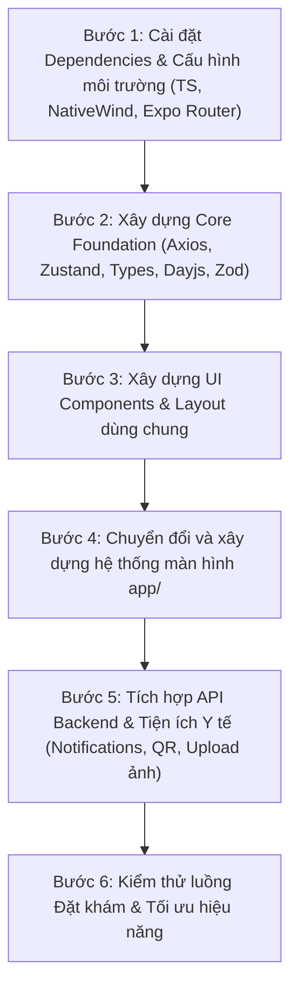

# KẾ HOẠCH NÂNG CẤP VÀ TÁI CẤU TRÚC ỨNG DỤNG (FE_CLINIC_APP)

> [!IMPORTANT]
> Đây là bản kế hoạch tổng hợp sự thay đổi và lộ trình triển khai chi tiết. Quá trình nâng cấp mã nguồn sẽ **chỉ được tiến hành sau khi bạn kiểm tra và duyệt bản kế hoạch này**.

---

## 1. TỔNG HỢP SỰ THAY ĐỔI (CURRENT VS PROPOSED)

| Phân hệ / Tiêu chí | Hiện tại (`fe_clinic_app`) | Đề xuất mới (`my-clinic-app`) | Lợi ích đạt được |
| :--- | :--- | :--- | :--- |
| **Ngôn ngữ** | JavaScript (`.js`) thuần | **TypeScript (`.ts`, `.tsx`)** | Tránh lỗi runtime `undefined`, gợi ý code và kiểm tra kiểu dữ liệu bệnh nhân/bác sĩ chặt chẽ. |
| **Điều hướng (Routing)** | React Navigation v7 tập trung ([AppNavigator.js](file:///d:/Khóa luận/Project-Clinic/fe_clinic_app/src/navigation/AppNavigator.js)) | **Expo Router** (File-based routing tại `app/`) | Hỗ trợ Typed Routes, Deep Linking tự nhiên khi người dùng nhấn vào thông báo nhắc khám. |
| **Giao diện & Styling** | `StyleSheet.create` cơ bản | **NativeWind v4 + Tailwind CSS** (`className`) | Tăng tốc độ viết UI lên 2-3x, code gọn gàng, đồng bộ màu sắc và khoảng cách chuẩn thiết kế. |
| **Bàn phím** | Mặc định | Bàn phím hệ điều hành + Xử lý cuộn tự nhiên | Gõ phím mượt mà, không che khuất ô nhập liệu khi điền hồ sơ bệnh án. |
| **Quản lý Client State** | `useState` phân tán + gọi `getSession()` thủ công | **Zustand** (`useAuthStore`, `useBookingStore`) | Quản lý luồng đặt khám nhiều bước (multi-step) liền mạch; không bị mất dữ liệu khi chuyển bước. |
| **Quản lý Server State** | `fetch` rời rạc ở từng màn hình | **`@tanstack/react-query` + Axios** | Tự động cache danh sách bác sĩ, tự refetch trạng thái slot khám theo thời gian thực, tự gắn token xác thực. |
| **Xử lý Form & Kiểm tra** | `useState` cho từng input, alert thủ công | **React Hook Form + Zod** | Form nhẹ, không re-render toàn màn hình; validate định dạng SĐT, CCCD/CMND, BHYT chuẩn xác. |
| **Nghiệp vụ Đặt khám** | Màn hình chọn ngày/giờ đơn giản | **`react-native-calendars` + Grid Ca khám (Chips) + `dayjs`** | Trực quan hóa ngày khám, chỉ cho chọn các ca còn trống, xử lý múi giờ chuẩn GMT+7. |
| **Tiện ích Y tế** | Chỉ có QR Code | `expo-notifications`, `expo-image-picker`, giữ lại `react-native-qrcode-svg` | Nhắc lịch khám tự động, tải ảnh đơn thuốc/triệu chứng, quét QR check-in tại phòng khám. |
| **Tính năng sẵn có** | Đã có màn hình AI Chat, Quên mật khẩu, Xác thực OTP | **Bảo toàn và tích hợp vào cấu trúc mới** | Không làm mất các tính năng quan trọng đã xây dựng ở phiên bản trước. |

---

## 2. KIẾN TRÚC THƯ MỤC TRIỂN KHAI

```text
fe_clinic_app/
├── app/                                  # Định tuyến File-based theo Expo Router
│   ├── (auth)/                           # Nhóm xác thực
│   │   ├── _layout.tsx                   # Stack layout Auth
│   │   ├── login.tsx                     # Đăng nhập
│   │   ├── register.tsx                  # Đăng ký
│   │   ├── forgot-password.tsx           # Quên mật khẩu (bảo toàn từ bản cũ)
│   │   └── verify-otp.tsx                # Xác thực OTP (bảo toàn từ bản cũ)
│   ├── (tabs)/                           # Nhóm màn hình chính (Bottom Tabs)
│   │   ├── _layout.tsx                   # Cấu hình thanh Tab dưới
│   │   ├── index.tsx                     # Trang chủ (Khám phá chuyên khoa, bác sĩ)
│   │   ├── appointments.tsx              # Quản lý lịch hẹn
│   │   ├── ai-chat.tsx                   # Trợ lý AI y tế (bảo toàn từ AIChatScreen)
│   │   ├── notifications.tsx             # Thông báo nhắc lịch khám
│   │   └── profile.tsx                   # Hồ sơ cá nhân & sức khỏe
│   ├── booking/                          # Luồng đặt lịch riêng biệt
│   │   ├── _layout.tsx                   # Stack điều hướng booking
│   │   ├── select-doctor.tsx             # Bước 1: Chọn bác sĩ / Chuyên khoa
│   │   ├── select-datetime.tsx           # Bước 2: Chọn ngày & ca khám (Slot Grid)
│   │   ├── patient-info.tsx              # Bước 3: Điền triệu chứng, upload ảnh đơn thuốc
│   │   └── [id].tsx                      # Bước 4: Chi tiết xác nhận & mã QR phiếu khám
│   ├── _layout.tsx                       # Root Layout (QueryClientProvider, NativeWind, Safe Area)
│   └── +not-found.tsx                    # Màn hình điều hướng 404
│
├── src/                                  # Mã nguồn nghiệp vụ & UI dùng chung
│   ├── components/
│   │   ├── common/                       # Button, Input, LoadingOverlay, ScreenShell
│   │   ├── booking/                      # DoctorCard, MedicalCalendar, TimeSlotPicker, BookingSummaryCard
│   │   └── forms/                        # PatientForm (kết hợp React Hook Form + Zod)
│   ├── constants/
│   │   ├── colors.ts                     # Mã màu Primary (Medical Teal/Blue), Secondary, Alert
│   │   └── config.ts                     # Base URL backend, cổng API, timeout
│   ├── hooks/
│   │   ├── useBooking.ts                 # Hook nghiệp vụ đặt khám & lock slot
│   │   └── useNotifications.ts           # Hook cấu hình thông báo nhắc khám
│   ├── services/
│   │   ├── api.ts                        # Axios instance + Request/Response Interceptor
│   │   ├── authService.ts                # Đăng nhập, đăng ký, OTP
│   │   ├── doctorService.ts              # Lấy danh sách bác sĩ, chuyên khoa
│   │   ├── appointmentService.ts         # Tạo lịch, tra cứu lịch, hủy lịch
│   │   └── aiService.ts                  # Gọi API Chatbot AI
│   ├── store/
│   │   ├── useAuthStore.ts               # Token, thông tin user hiện tại (persist)
│   │   └── useBookingStore.ts            # State tạm thời qua 3 bước đặt khám
│   ├── types/
│   │   ├── user.ts                       # Interface User, AuthSession
│   │   ├── doctor.ts                     # Interface Doctor, Department, Specialty
│   │   ├── appointment.ts                # Interface Appointment, Slot, BookingPayload
│   │   └── navigation.ts                 # Typed Routes params
│   └── utils/
│       ├── date.ts                       # Format ngày giờ bằng Day.js (GMT+7)
│       └── validation.ts                 # Schema Zod kiểm tra form
│
├── global.css                            # Directive Tailwind (@tailwind base; components; utilities;)
├── tailwind.config.js                    # Cấu hình đường dẫn quét class
├── metro.config.js                       # Tích hợp NativeWind vào Metro Bundler
├── tsconfig.json                         # Khai báo compilerOptions và alias (@/*)
├── app.json                              # Cấu hình quyền máy ảnh, thông báo, deep linking
└── package.json                          # Dependencies cập nhật
```

---

## 3. LỘ TRÌNH TRIỂN KHAI CHI TIẾT (6 BƯỚC)



### Bước 1: Chuẩn bị môi trường & Nâng cấp thư viện
1. Cài đặt các gói thư viện mới:
   - **Router & Types**: `expo-router`, `typescript`, `@types/react`, `@types/react-native`.
   - **UI & Style**: `nativewind@^4.0.1`, `tailwindcss`, `react-native-reanimated`.
   - **Đặt lịch**: `react-native-calendars`, `dayjs`.
   - **Dữ liệu & Form**: `@tanstack/react-query`, `axios`, `zustand`, `react-hook-form`, `zod`, `@hookform/resolvers`.
   - **Tiện ích**: `expo-notifications`, `expo-image-picker`, `expo-image`, giữ `react-native-qrcode-svg`.
2. Tạo các file cấu hình nền tảng:
   - [tsconfig.json](file:///d:/Khóa luận/Project-Clinic/fe_clinic_app/tsconfig.json) (Path Alias `@/*` trỏ vào `./src/*` và `./app/*`).
   - [tailwind.config.js](file:///d:/Khóa luận/Project-Clinic/fe_clinic_app/tailwind.config.js) & [global.css](file:///d:/Khóa luận/Project-Clinic/fe_clinic_app/global.css).
   - [metro.config.js](file:///d:/Khóa luận/Project-Clinic/fe_clinic_app/metro.config.js) kết hợp với `withNativeWind`.
   - Cập nhật [app.json](file:///d:/Khóa luận/Project-Clinic/fe_clinic_app/app.json) (hỗ trợ `scheme` cho Deep Linking).

### Bước 2: Xây dựng tầng Logic Core (Services, Stores & Types)
1. **Types**: Định nghĩa chuẩn toàn bộ interface (`Doctor`, `Department`, `Appointment`, `TimeSlot`, `User`, `BookingDraft`).
2. **Axios Client**: Thiết lập [api.ts](file:///d:/Khóa luận/Project-Clinic/fe_clinic_app/src/services/api.ts) tự động nhận diện IP dev máy chủ (kế thừa từ logic [apiBase.js](file:///d:/Khóa luận/Project-Clinic/fe_clinic_app/src/api/apiBase.js)), tự động gắn Bearer Token từ `useAuthStore`.
3. **Zustand Stores**:
   - `useAuthStore`: Quản lý đăng nhập, lưu token an toàn với `AsyncStorage`.
   - `useBookingStore`: Giữ thông tin nháp: `{ doctorId, specialtyId, date, slotId, patientInfo, symptoms, images }` và các hàm `setDoctor()`, `setDateTime()`, `resetBooking()`.
4. **Utils**:
   - `date.ts`: Định dạng ngày chuẩn tiếng Việt (Thứ, ngày/tháng/năm), xử lý múi giờ GMT+7.
   - `validation.ts`: Zod schema kiểm tra số điện thoại Việt Nam (10 số, đầu số hợp lệ), họ tên, ngày sinh, CCCD.

### Bước 3: Xây dựng UI Components tái sử dụng
1. `components/common/`: Button, Input, LoadingOverlay, ErrorBanner theo phong cách Tailwind hiện đại.
2. `components/booking/`:
   - `DoctorCard.tsx`: Hiển thị thông tin bác sĩ, học vị, giá khám, xếp hạng.
   - `MedicalCalendar.tsx`: Bọc `react-native-calendars` với theme y tế sạch sẽ, vô hiệu hóa các ngày trong quá khứ và ngày nghỉ.
   - `TimeSlotPicker.tsx`: Render lưới nút (Chips) cho ca khám sáng/chiều, phân biệt trực quan ca còn trống, ca đã đặt, ca đang chọn.
3. `components/forms/PatientForm.tsx`: Ô nhập triệu chứng, chọn người khám (bản thân / người thân), upload ảnh đơn thuốc cũ/kết quả cận lâm sàng.

### Bước 4: Triển khai các màn hình theo cấu trúc Expo Router (`app/`)
1. **Root Layout** (`app/_layout.tsx`): Nạp `global.css`, `QueryClientProvider`, `SafeAreaProvider`, StatusBar.
2. **Auth Group** (`app/(auth)/`):
   - Màn hình `login.tsx`, `register.tsx`, `forgot-password.tsx`, `verify-otp.tsx`.
3. **Tab Group** (`app/(tabs)/`):
   - `index.tsx`: Màn hình chủ (Tìm kiếm, khoa phòng, bác sĩ tiêu biểu, banner đặt khám).
   - `appointments.tsx`: Danh sách lịch hẹn đã đặt (Sắp tới, Đã khám, Đã hủy).
   - `ai-chat.tsx`: Trợ lý AI tư vấn sức khỏe thông minh.
   - `notifications.tsx`: Danh sách thông báo nhắc lịch và cập nhật trạng thái.
   - `profile.tsx`: Thông tin cá nhân, đổi mật khẩu, đăng xuất.
4. **Booking Flow** (`app/booking/`):
   - `select-doctor.tsx`: Lọc theo chuyên khoa và chọn bác sĩ.
   - `select-datetime.tsx`: Chọn ngày trên lịch và chọn khung giờ trống.
   - `patient-info.tsx`: Nhập thông tin người khám & upload ảnh hồ sơ bệnh án.
   - `[id].tsx`: Màn hình xác nhận thành công, hiển thị chi tiết lịch hẹn kèm mã QR Code để quét check-in.

### Bước 5: Tích hợp API Backend & Tiện ích y tế
1. Kết nối TanStack Query với các service API của phòng khám.
2. Thiết lập hook `useNotifications.ts` để cấu hình lịch hẹn nhắc tự động trước 24h hoặc 2h.
3. Tích hợp `expo-image-picker` cho phép chụp hoặc chọn ảnh bệnh án gửi kèm theo lịch hẹn.
4. Tích hợp `react-native-qrcode-svg` tại trang chi tiết lịch hẹn để lễ tân quét mã khi bệnh nhân đến khám.

### Bước 6: Kiểm thử & Nghiệm thu
1. Kiểm tra biên dịch TypeScript (`tsc --noEmit`) bảo đảm không còn lỗi Type.
2. Kiểm tra giao diện và luồng đặt khám từ A đến Z trên cả Android và iOS qua Expo Go.
3. Kiểm tra tính năng hoạt động offline / mất mạng đột ngột.

---

> [!TIP]
> **Quyết định tiếp theo**: Bạn có thể xem xét bản kế hoạch trên. Nếu cần điều chỉnh hoặc bổ sung thêm yêu cầu nào, hãy cho tôi biết; hoặc nếu bạn đồng ý, hãy phản hồi **"Duyệt kế hoạch"** hoặc bấm nút xác nhận để bắt đầu triển khai từng bước!
